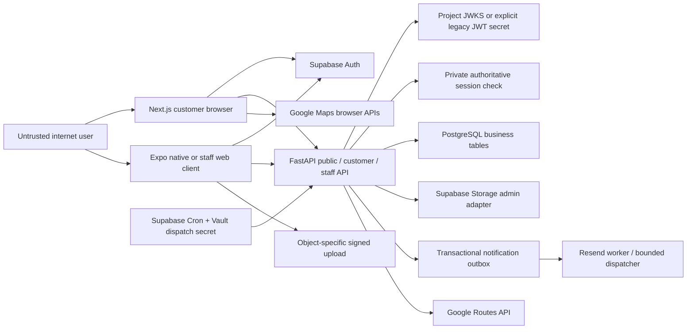

# Trifecta security assessment and hardening

**Current assessment:** [STAGING_FINAL.md](STAGING_FINAL.md) supersedes historical counts, staging status and unresolved-MFA observations below. Native staging verification is complete for its stated cases; production is untouched. Final suites: 470 backend passed / 2 skipped, 221 website passed, 180 mobile passed. Production release remains blocked by the final report's observed failures and manual gates. Initial evidence below is retained as historical.

Assessment date: **11 November 2026**. Scope: the checked-out repository, a new isolated PostgreSQL 17 test cluster, and read-only Supabase catalog/advisor inspection. **No production deployment, migration, charge, refund, password reset, credential rotation, customer-data extraction, or production attack scan was performed.**

**Release decision: BLOCKED pending the manual gates below.** Confirmed code weaknesses were fixed locally and exercised with synthetic data. The assessment does not establish complete security or ASVS Level 2 compliance. The requirement-by-requirement matrix intentionally records partial or unavailable verification as NOT TESTED.

Final automated results: **446 backend tests passed, 2 skipped; 221 website tests passed; 177 mobile tests passed.** The conservative ASVS register records 9 PASS, 2 FAIL, 236 NOT TESTED/partial and 6 NOT APPLICABLE. The large remaining verification set is explicit; the local test count is not a substitute for full ASVS verification.

## Read this evidence together

- [Architecture, findings and release decision](REPORT.md) — this report.
- [Every API operation](ENDPOINTS.md), with method, source, authentication boundary and anonymous-request result.
- [Every application table and the provider database-object inventory](DATABASE.md).
- [All 253 ASVS 5.0.0 L1/L2 requirements](ASVS.md).
- [Every collected backend test and its individual result](TESTS.md).
- [Reproduction and release procedure](RUNBOOK.md).
- Raw machine-readable evidence is in [evidence](evidence/), including pre-fix exploit failures, final JUnit results, dependency scans, sanitized database metadata, role tests and local production HTTP headers.

Status meanings: **PASS** = the stated check actually ran and satisfied its assertions; **FAIL** = the stated check ran and demonstrated a weakness; **NOT TESTED** = unexecuted, skipped, partially verified, unavailable or outside the tested environment; **NOT APPLICABLE** = the referenced mechanism is absent from the identified application path. A fixed local test is not evidence that production is fixed.

## Architecture and trust boundaries

This is a modular monolith with separate clients, rather than three interchangeable API layers:

1. **Browser/native → Auth:** Supabase issues and refreshes sessions. Customer email/password, magic links, email OTP and password recovery call the provider directly. Staff usernames are transformed into synthetic Auth email addresses; server-side staff administration uses the Auth Admin API. There is no custom password database or hashing scheme to replace.
2. **Client → FastAPI:** bearer JWTs establish identity, not application role. `staff_profiles`, active state, business state, team membership and service-level ownership checks establish authority. Guest booking and complaint flows deliberately have unauthenticated entry points.
3. **FastAPI → PostgreSQL:** the original connection configuration permits an owner-like `postgres` role, and RLS does not filter its queries. Source and inspected metadata confirm that direct-client business-table access is intended to be denied. The new `trifecta_runtime` group is not an owner, cannot bypass RLS, and receives DML through explicit backend-only policies. **It still sees all tenants: FastAPI is the tenant/object authorization boundary.** This is not JWT-per-tenant database RLS.
4. **API → Auth Admin/Storage:** the service-role credential bypasses ordinary client restrictions. It remains backend-only. All object paths are derived from an authorized business/job/expense/complaint, rather than accepted as arbitrary client paths. Upload and download grants are capabilities; possession permits the granted operation until provider expiry.
5. **Public booking → customer ownership:** public requests cannot assign a customer ID, total, paid state or staff role. Authenticated ownership comes from the verified subject and the authoritative customer profile. Staff-assisted matching requires unambiguous same-tenant phone plus email, rather than phone alone.
6. **Database → notification processor:** authoritative changes and outbox messages commit together. Workers claim bounded batches with row locks; retries use dedupe keys. Provider requests occur outside booking transactions. The dispatch endpoint requires a constant-time secret comparison. Cron Vault values and real mail delivery were not inspected.
7. **Payment boundary:** actual active operations are staff cash/tender accounting and financial ledgers. The repository contains a fake payment adapter and provider protocol, but no wired production online gateway or payment webhook. “Pay Now” is now rejected before consuming a hold. Webhook signature, real refund, card tokenization and PCI-provider responsibilities cannot be verified for an integration that is not implemented.

Customer names, email, phone, addresses, coordinates, vehicle plates, appointment history and evidence enter through validated API schemas and persist in business tables/private storage. Public reviews use a separate reduced response model. Booking emails and invoices intentionally contain customer details; Google Maps/Routes and Resend are external processors. Browser tokens use provider-managed JavaScript storage; native tokens use Expo SecureStore. Operational mobile query data now remains in memory and is cleared on logout. Exact processor contracts, region requirements and legal retention periods require owner review.

## Executed verification

The final canonical backend result is in `evidence/all-backend-tests.xml` and the regenerated [test inventory](TESTS.md). Earlier failed runs are retained where they demonstrate an exploit or test-harness repair; they are not presented as final passing runs.

| Check | Result | Evidence and limits |
|---|---|---|
| Endpoint inventory | PASS | 161 application operations found by AST; framework `/docs`, `/redoc`, `/openapi.json` also considered and disabled in deployed mode. |
| Anonymous customer/staff access | PASS | All **144** protected operations returned 401 in a real local API/database harness; this alone does not prove every authorized object/role combination. |
| Direct database roles | PASS | **64 tables × 2 roles × 5 operations = 640** real SQL attempts. `anon`/`authenticated` cannot SELECT/INSERT/UPDATE/DELETE/TRUNCATE after migration. Backend role cannot TRUNCATE and can perform intended reads. |
| Customer/tenant/team negative cases | PASS | Real locally signed JWTs, separate synthetic customers/employees/managers/admin, two tenants, a restricted backend role. Address and booking IDOR, staff-role spoofing, team and tenant access are rejected. |
| Intentional employee overlap | PASS | Authorized own-team overlap is idempotent; customer/other-team attempts fail; the original job response remains unchanged. Existing capacity and concurrent confirmation tests also run. |
| Price/payment tampering | PASS | Submitted total/paid fields rejected; authoritative total returned; online-payment path fails closed; cash/tender/change and concurrent accounting regressions run. No real financial transaction. |
| Logout/ban/verification state | PASS locally | Real private function queries and an actual API request reject removed sessions, bans and unverified synthetic users. No live provider logout/recovery flow was exercised. |
| Request memory bounds | PASS | Declared and chunked oversized bodies receive 413 before parsing or handler execution. Distributed ingress capacity remains NOT TESTED. |
| Uploaded image validation | PASS locally | Forged raster magic bytes/MIME metadata rejected; Pillow verifies/decodes only JPEG/PNG/WebP with byte/pixel/frame bounds. Signed upload is non-overwriting. Live Storage workflow is NOT TESTED. |
| Local migration chain and rollback | PASS | Complete Alembic chain applied in the security database; downgrade/upgrade of the new hardening revision preserves synthetic customer rows. Existing older optional migration scenario tests remain skipped unless explicitly enabled. |
| Website regression/build | PASS | 221 Vitest tests; local Next.js 16.4.6 production build; real loopback `/login` response verifies six security headers. Full browser/CSP/Google Maps interactions remain NOT TESTED. |
| Mobile regression/types | PASS | 177 Vitest tests and workspace TypeScript checks, including logout, persistence rejection, immutable upload retry, and repeatable native-config transformation. Native release signing/device execution remains NOT TESTED. |
| Python lint/type checking | PASS | Ruff on application code; mypy on the changed authentication/HTTP/storage modules. |
| Python static security scan | PASS with reviewed informational hits | Bandit and Ruff security rules ran. Bandit retained two low-severity invariant `assert` notices; these are not role/authentication gates. |
| npm advisory scan | FAIL: residual moderate findings | Initially 30 (2 critical, 10 high, 17 moderate, 1 low); after compatible updates **10 moderate, 0 high, 0 critical**. See exact chains in `npm-audit-after.json`. |
| Python advisory scans | PASS for scanned packages | Offline PyPA comparison prompted PyJWT/certifi/Mako/pytest fixes; independent pip-audit found dnspython, then reported no known vulnerabilities after its update. The local application distribution is not on PyPI and was skipped; its code was audited separately. |
| Secret scanning | PASS within stated scanner coverage | detect-secrets working-tree scan and targeted offline history scan. 54 commits, 1,487 reachable blobs, 1,460 text blobs scanned, 27 binary/large blobs excluded. Known local/example credentials and migration hashes triaged; no confirmed production credential disclosure or automatic rotation. |
| Vercel configuration | NOT TESTED | Team-scoped connector requests returned 403; consent link was provided. No alternative credentials or scope bypass was attempted. |
| Supabase live RLS catalog | PASS for catalog inspection | 61 public tables have RLS enabled; live revision `dbd74a2d3de9`; no public application views. This was metadata inspection, not a live exploit. |

## Findings, impact, remediation and regression evidence

The severity rates realistic impact and prerequisites. Dependency advisory severity does not imply every vulnerable feature is exposed. “Fixed” below means the repository/local test environment; production remains unchanged.

| ID | Severity | Root cause and realistic impact | Safe evidence | Local fix / verification |
|---|---|---|---|---|
| F01 | Critical, conditional | Installed Next.js 16.3.2 matched critical RCE/cache/SSRF advisories; hosting platform and exercised feature determine exploitability. Other dependency chains included high/critical build-tool findings. | Before/after npm JSON; no RCE payload or production attack. | Next/ESLint config 16.4.6 and compatible lockfile updates; build and 221 web tests PASS. Critical/high counts now zero; moderate chains remain. |
| F02 | High | Employee team directory was tenant-scoped but not membership-scoped, exposing another team's member details and operational summary. | `team-scope-before.xml`: real employee received 200 where 404 required. | Membership filter in `workforce.list_teams`; own-team success and other-team denial PASS. |
| F03 | High | A direct upload grant allowed overwrite (`upsert=true`), so a valid/stolen grant could replace evidence after metadata validation; MIME/size metadata alone did not establish safe content. | Pre-fix signed-upload assertion failed; forged image and misleading MIME regression cases. Actual provider overwrite NOT TESTED. | Non-overwriting grants, bounded server reads and raster decoding before finalization. Retry of an existing immutable object proceeds to authorized finalization. PDF finalization stays blocked pending scanning. |
| F04 | High | New public holds/bookings lacked a cross-process abuse budget, allowing slot exhaustion, database/outbox growth and mail expense. Complaint/review-specific counters did not cover the booking surface. | Source review; 20 concurrent synthetic IPv6 addresses in the same /64 now yield exactly 12 accepted writes. No load attack. | Shared PostgreSQL peer/global counters, IPv6 /64 grouping and bounded bodies. Deployed-mode wiring is explicit; trusted proxy configuration and distributed traffic remain manual gates. |
| F05 | Medium | JWT signature validation alone continued to authorize a stolen token after session revocation/ban until JWT expiry. | Synthetic session is removed/banned/unverified; direct function and actual API replay now fail. | Deployed authenticated requests check `session_id` plus subject through private, tightly granted Supabase session/user lookup. Staff/business active state remains authoritative. |
| F06 | Medium | Default validation responses echoed request values, including oversized passwords and private fields. | `exploits-before.xml`: synthetic password returned in 422 response. | Central validation handler omits input/context and uses fixed messages; regression PASS. Settings validation also hides input values in errors. |
| F07 | Medium, issuer prerequisite | PyJWT validated `exp` if present but did not require it; a signed token without expiry was accepted. This does not let an unsigned internet user mint tokens. | Pre-fix missing-exp test fails; signed missing/invalid claims and signature tests. | Require exp/sub/aud/iss, retain fixed algorithms and issuer/audience validation; legacy secret requires issuer configuration. PASS. |
| F08 | Medium | Fresh-cache unknown key IDs forced repeated remote JWKS downloads, creating an unauthenticated provider-amplification path. | Four random kids produced four provider requests before fix. | Single refresh per 30-second unknown-kid window; cached known keys still work; stale fallback bounded. Cryptographic/cache regressions PASS. |
| F09 | Medium | Production settings accepted wildcard credentialed CORS and staging could use the development management key. | Pre-fix settings regression; explicit-origin tests. | Exact HTTPS origins, strong non-development keys in staging/production, deployed HTTPS validation; PUT added to the explicit method list for legitimate checklist operations. PASS locally; production variables unknown. |
| F10 | Medium | Database configuration did not explicitly require verified TLS for a deployed connection. Default transport negotiation is not a defensible certificate-validation guarantee. | Source/config inspection; actual production handshake NOT TESTED. | Deployed engines use a default validating SSL context; disabling TLS is rejected. Actual Supabase host/certificate compatibility is a release gate. |
| F11 | Medium | Return-path validation accepted `/\\host`, which URL parsers normalize into an external origin; enables post-auth redirect phishing. | Browser URL normalization and negative unit cases, including backslash/control/encoded-backslash inputs. | Strict local-path checks and final trusted-origin comparison; redirect tests PASS. Full browser sign-in chain NOT TESTED. |
| F12 | Medium | Operational personal data persisted in plaintext AsyncStorage and survived logout in memory/persistence. Role-scoped cache keys do not erase data from a shared/stolen device. | Original cache/logout source; real QueryClient synthetic private record and cancellation-failure regression. | Memory-only operational cache, legacy-cache removal, logout clears memory/disk even if cancellation fails; native backups disabled. Mobile regressions PASS; forensic device test NOT TESTED. |
| F13 | High if distributed as configured | Android release used the known debug signing key. Someone holding that key could sign a replacement for such a distributed package. | Gradle configuration and checked-in debug keystore; no package forged or installed. | Release signing requires dedicated environment-supplied credentials and fails closed; repeatable Expo prebuild plugin. Transformation PASS; actual native release build and installed-package migration NOT TESTED. |
| F14 | Medium | API accepted the incomplete online-payment branch even though the UI labels it unavailable, creating unusable pending appointments rather than a provider-verified payment workflow. | Real API now rejects Pay Now then successfully books the same unconsumed hold via supported payment choice. | Fail closed before hold consumption; no real charge/refund attempted. PASS. |
| F15 | Low | Expired idempotency records were ignored on read but still occupied a unique key, causing retries to fail during insert. | Real PostgreSQL expired-row retry regression. | Reclaim only the expired, exact-scope record under the existing advisory lock. PASS; business-resource/event constraints still protect financial retries. |
| F16 | Medium | Profile upsert reactivated an inactive customer; new staff temporary-password accounts did not initially force a change. Public callers could also label a booking source “admin”. | Upsert/create/schema source; inactive-profile, account workflow and forbidden-source regressions. | Active-row predicate on upsert, forced initial password change, public source allowlist. Verified in final backend suite. |
| F17 | High, OPEN | Privileged application routes do not require elevated MFA assurance; staff login has no verified enrollment/challenge path. A stolen manager/admin password is sufficient for broad operations. | Code review; no AAL2 gate/enrollment flow found. No real account attacked. | **Manual/product implementation required.** Enroll and enforce appropriate privileged MFA, recovery, and reauthentication without bypassing the provider. Not fixed or claimed tested. |
| F18 | Medium, OPEN | Supabase leaked-password protection is disabled in inspected project. | `supabase-advisors.json`; provider password database not read. | Owner must enable/configure provider controls and verify policy/plan support. No production Auth setting changed. |
| F19 | High release blocker, OPEN | Live schema is four revisions behind the new source head; complaint and expense evidence buckets are absent. Deploying this build directly could break security-state/session/evidence workflows. | Catalog revision and bucket metadata only. | Stage full chain and private bucket setup, then separately authorize release. No production schema or storage change. |
| F20 | Low | Broad live client table privileges include operations such as TRUNCATE that RLS does not mediate; public event-trigger function has unnecessary EXECUTE grants. No exposed exploit path was demonstrated. | ACL/function source metadata; advisor warning reviewed in context. | New migration revokes direct client/PUBLIC grants, narrows defaults and function execution. 640 real permission denials PASS locally. |

Security-header hardening also adds no-store to API responses (including authorization errors), nosniff, referrer restrictions, frame protection and deployed HSTS. Web/static staff configurations add CSP and disable public source maps/powered-by disclosure. These are defense-in-depth changes, not evidence that stored XSS was present. CSP still permits inline scripts/styles for framework compatibility; a strict nonce/hash rollout and real browser validation remain open.

## Authentication and password assessment

No application password/hash column or custom password comparison was found. Password fields exist in request schemas and are forwarded over the server-side/provider Auth interfaces; no double hashing was introduced. Supabase documents bcrypt with unique salts for its password storage. **The provider's actual password hashes, cost configuration, reset-token database, OTP generation/expiry, refresh reuse policy, SMTP templates, anti-enumeration responses, CAPTCHA and throttling settings were not dynamically inspected.** Provider documentation is not a PASS for those deployed controls.

JWT verification is now strict about required security claims and pinned algorithms. Roles never come from `user_metadata` or a client role field. Privileged account creation/reset checks the authoritative actor and target role; managers cannot create/administer administrators through these routes. Temporary credentials are shown only to authorized staff and API caching is disabled. Staff suspension and inactive businesses are checked from SQL. Customer deletion tombstones prevent stale identity recreation; an inactive profile cannot reactivate itself through upsert.

Web/native applications use bearer authorization rather than an ambient application session cookie. Therefore cookie Secure/HttpOnly/SameSite and classic cookie-based CSRF are **NOT APPLICABLE to this application bearer path**; this does not assess Supabase's hosted pages/cookies or hypothetical future cookie endpoints. JavaScript token storage remains exposed to successful XSS. Recovery proof remains entirely with Supabase; a local `PASSWORD_RECOVERY` flag does not independently authorize an Auth API password change. Real signup, OTP, reset-token replay, logout across devices and MFA recovery tests remain release work.

Booking management tokens are high-entropy signed capabilities with stored hashes and fragment/header transport. Guest-review proofs are purpose/device-bound and expire after 30 minutes; unique review constraints prevent duplicate submission. **Booking management capabilities themselves have no individual expiry/revocation UI**: forwarded/stolen links remain a residual privacy risk until token hash/key lifecycle or record anonymization changes access. This requires a deliberate guest-access lifecycle policy.

## Database and storage assessment

The full [table matrix](DATABASE.md) separates live metadata from migrated local permission results. All 61 live public business/version tables had RLS enabled, no direct-client policies, and owner `postgres`. No public application view was found, so a view-mediated application RLS bypass was not demonstrated. Other provider relations/views and all 117 non-system function signatures/ACLs are inventoried in raw evidence. **Provider function implementations were not comprehensively penetration-tested.**

Do not replace this access model with generic `auth.uid()` policies: many operational tables do not belong directly to one Auth subject. The API needs cross-table transactional access. The migration explicitly implements the backend group policy and client denial, and avoids FORCE RLS against the migration owner. It changes no existing business records. Downgrade removes the new counter/function/policies but deliberately does not restore excessive client grants or remove a potentially shared role/schema. Operational rollback must preserve a least-privilege access path.

Live Storage had one private `job-quality-photos` bucket with an 8 MiB limit and JPEG/PNG/WebP allowlist. Source also requires private `complaint-evidence` (two 1 MiB attachments) and `expense-evidence` (10 MiB default). Complaint reads use manager tenant checks and 120-second URLs; job URLs default to 300 seconds. Stable object paths, rather than signed URLs, are persisted. Client image compression is not trusted for validation.

PDF evidence can contain active/embedded content. A byte-signature/string blacklist is insufficient, so new PDF finalization is blocked until proper malware scanning/content-disarm or a reviewed isolated rendering flow exists; image receipts remain supported. No antivirus, image EXIF stripping, orphan-upload cleanup, lifecycle retention or forensic device/storage penetration test was implemented. Private storage and decoder validation do not prove malware absence.

## Injection, business logic and resource review

Application database access uses SQLAlchemy expressions and bound parameters. Reviewed raw advisory-lock and rate-counter SQL uses parameters. Dynamic migration identifiers come from controlled catalog objects and PostgreSQL `%I`; migration code does not accept internet input. No application shell execution, pickle deserialization, NoSQL query interpreter, user-template evaluator or arbitrary outbound fetch was found. Stored Maps links are not fetched by the backend. ETA calls use a fixed Google endpoint and validated coordinates. These source findings are bounded to the repository, not third-party implementations.

React renders public text as text; email/invoice rendering uses context-appropriate escaping in reviewed paths. The layout's inline language bootstrap is fixed code, not a concatenation of customer content. Stored/reflected/DOM XSS in a real browser, extension behavior, file-handler behavior and malicious PDFs remain **NOT TESTED**. Unknown routes are logged as an unmatched route instead of reflecting arbitrary URL paths; validation payloads and auth headers are not logged by application middleware. Provider/platform logs, analytics, support exports and historic logs remain unverified.

Booking prices, service/add-on membership, ownership, coupons and loyalty rewards are resolved server-side. Customer capacity uses advisory/row locks; staff exceptions require staff identity, current team membership and explicit confirmation. Tests preserve the original appointment during an overlap. Cancellation cutoff checks run on the server and use configured hours; the seeded/default policy is 24 hours. Production business settings must be confirmed. Existing historical displaced appointments are not deleted or rewritten by this audit.

Abuse defenses now include shared global/peer counters and a 3 MiB ASGI body budget, including chunked requests. The write budget is 12 requests per IPv4 peer or IPv6 /64 per ten-minute bucket, with a global 300; reads use per-minute 120/2000 budgets. These are initial bounded budgets, not a capacity proof. Fixed-window bursts, distributed botnets, malicious authenticated staff bulk reads, timeouts and WAF limits still require staging measurement and trusted-ingress controls. No uncontrolled load test was run.

## Infrastructure, dependency and secret findings

Compatible npm updates were applied without executing dependency install scripts. No forced framework downgrade was applied: npm's remaining Expo recommendation includes an incompatible older major. Ten moderate Expo/glob/minimatch and TypeScript-ESLint chains remain in the lockfile; the exact dependency paths and fix suggestions are preserved. Do not expose development servers or build infrastructure publicly. Reassess target-platform reachability and patched upstream releases before approving the residual risk.

Python lower bounds now exclude identified vulnerable PyJWT, certifi, Mako and dnspython releases. The test runner was updated. `requirements-security.txt` records the audited resolved runtime constraints for Windows/Python 3.13; it is not a complete cross-platform hash-locked production image. Linux-only extras and actual hosting images must be re-resolved, pinned and scanned. Native Gradle/Maven/CocoaPods, OS images, malicious-package provenance and binary artifacts are not covered by npm/pip advisory success.

| Python component | Observed → patched | Assessment severity / actual exposure | Verification |
|---|---|---|---|
| PyJWT | 2.13.0 → 2.15.1 | High, conditional: multiple signature/JWK edge-case advisories; keys come from a configured project rather than arbitrary client JWKs. A production bypass was not demonstrated. | Exact advisory IDs/references in offline-before JSON; cryptographic and API regressions PASS with the patched library. |
| certifi | 2026.7.22 → 2026.10.23 | High, network-attacker prerequisite: compromised intermediate-CA trust issue affects outbound certificate validation. No interception was performed. | PYSEC-2026-4320; offline and independent pip scans clear after update. |
| Mako | 1.4.1 → 1.4.3 | Medium, constrained exposure: Windows template-lookup path traversal; used by migration tooling with repository templates, not an internet template route. | PYSEC-2026-4243; patched version plus migration/regression suite. |
| dnspython | 2.8.0 → 2.9.2 | Medium: crafted DNS decompression can consume CPU. Pydantic email validation does not establish an exposed arbitrary DNS-parser endpoint. | CVE-2026-114605 / GHSA-45c3-73f7-pv4m; pip-audit before/after preserved. |
| pytest | 8.4.2 → 9.2.0 | Medium on affected Unix shared hosts; NOT APPLICABLE to the Windows-specific exploit path tested here. Development/test runner, not an application route. | PYSEC-2026-1845; full tests pass after update. |

These are confirmed version/advisory matches, not claims of successful exploitation. `python-advisories-before.json`, `pip-audit-before-dns.json`, `python-advisories-after.json` and `pip-audit.json` preserve the exact package/advisory evidence. All remaining npm package severities, chains, affected ranges and provider fix suggestions are in `npm-audit-after.json`; there are no hidden high/critical exceptions in that result.

detect-secrets candidates consisted of examples/local credentials, test data and immutable migration hash identifiers after triage. The targeted history scanner does not prove absence of secrets in excluded binary/large blobs. The checked-in Android debug keystore is a known development credential and is now forbidden for release signing; any already-distributed debug-signed package needs an explicit signing migration plan. No other discovered credential was confirmed compromised; none was rotated automatically. If deployment logs, chat history or excluded artifacts contain a real key, rotate the corresponding Supabase service/JWT/database, Resend, dispatch, Maps or signing credential through the owner-controlled process.

Vercel project/team settings, production environment separation, deployment protection, public source maps actually served, TLS certificates, edge caching, firewall, source/Git exposure and secrets access could not be checked because team access remained denied. No tracked CI security gate/container definition was found in the inspected inventory; repository protection, CI token permissions and hosting-installed integrations require authenticated owner inspection. Backup encryption, retention, access, point-in-time recovery and restore drills were not verified. Supabase `pg_net` in the public schema remains an advisor warning requiring extension-compatible review, not an automatic destructive relocation.

## Standards mapping and assurance limits

Baseline sources verified during this assessment:

- [OWASP ASVS 5.0.0 stable](https://github.com/OWASP/ASVS/tree/v5.0.0) — all 253 L1/L2 rows indexed in [ASVS.md](ASVS.md); many remain partially verified/NOT TESTED.
- [OWASP Top 10:2025](https://top10.owasp.org/2025/en/): A01 access control → F02/F05/F16/F20; A02 misconfiguration → F09/F10/F13/F19; A03 supply chain → F01/dependencies; A04 cryptography → token/TLS/provider review; A05 injection → ORM/encoding/negative query tests; A06 insecure design → F03/F04/F14; A07 authentication → F05/F07/F17/F18; A08 integrity → evidence/idempotency; A09 logging/alerting → log review plus unverified production alerting; A10 exceptional conditions → validation, bounded errors and tested rollback.
- [OWASP API Security Top 10:2023](https://api-security.owasp.org/editions/2023/en/0x11-t10/): API1/3/5 → object/property/function negatives; API2 → JWT/session tests and open MFA; API4/6 → counters/body bounds and residual distributed abuse; API7 → outbound trust review; API8/9 → configuration/inventories; API10 → provider adapter review and untested live integrations.
- [OWASP WSTG stable 4.2](https://owasp.org/www-project-web-security-testing-guide/): configuration, identity, authentication, authorization, session, input validation, error handling, cryptography, business logic and client testing categories drive the inventory. Version 5 is a development branch, not the selected stable baseline.
- Supabase [RLS](https://supabase.com/docs/guides/database/postgres/row-level-security), [password security](https://supabase.com/docs/guides/auth/password-security), [session revocation](https://supabase.com/docs/guides/auth/sessions), and [private Storage](https://supabase.com/docs/guides/storage/security/access-control).

This is substantial source/local regression evidence and a live database metadata assessment. It is not a complete independent production penetration test, a provider audit, legal/privacy opinion, PCI DSS attestation, ASVS certification, or a real-device/mobile binary assessment. Passing checks apply to the assertions, roles, identities, data, versions and environment actually exercised.

## Mandatory production-release blockers

1. **Stage before release.** Apply the complete chain through `c7e833583da3` to an isolated Supabase staging project; verify private session function and the real Auth/Storage APIs. Confirm policy compatibility and backup restoration before a separately authorized production migration/deployment.
2. **Privileged authentication.** Implement and verify manager/admin MFA enrollment, challenge, elevated assurance, recovery and sensitive-operation reauthentication. Verify Auth password length/breach protection, OTP/reset limits and expiry, email confirmation, non-enumeration and CAPTCHA/abuse controls.
3. **Deployment access/configuration.** Obtain Vercel team authorization; verify exact environments, `APP_ENV=production`, HTTPS origins/URLs, strong backend secrets, issuer/audience, verified database TLS, no public backend keys, cache/WAF/rate/timeout settings and protected administrative/build surfaces.
4. **Database credentials.** Adopt a dedicated non-owner login inheriting `trifecta_runtime`; keep migration/owner credentials separate. Verify real role memberships, session-function permissions, PostgREST exposed schemas and all future migration defaults. Do not grant the runtime group to client roles.
5. **Storage and files.** Create/verify required private buckets with size/type limits and deny client listing. Exercise separate customers/teams/tenants against signed uploads and downloads, expiry and retry. Keep PDF finalization blocked until a reviewed scan/CDR path exists. Define orphan, EXIF and retention handling.
6. **Release/package verification.** Resolve or explicitly accept the ten moderate npm findings with actual exposure evidence. Rebuild and test the real Android/iOS release artifacts with a dedicated protected signing key, backup/network defaults and logout/cache behavior. Verify the existing installed-package signing migration before distribution.
7. **Browser/session integration.** Run actual signup/verification/OTP/recovery/logout/password-change/MFA flows and cross-device replay tests in isolated staging. Exercise Maps, CSP, stored input, error states and mobile web callbacks. Tighten CSP to nonces/hashes where feasible.
8. **Operations and privacy.** Verify monitoring/incident alerts, secret rotation procedures, backup restore, employee offboarding, evidence/customer/invoice retention and deletion policy. Confirm that account-deletion failures at Auth Admin have an operational retry/reconciliation path.
9. **Financial boundaries.** Keep online payment disabled until a real provider flow, authenticated idempotent webhooks, amount reconciliation and authorized refunds are implemented and tested without real charges in staging. Confirm cash/cancellation policy settings and ledger reconciliation.

No production release is authorized by this report.
